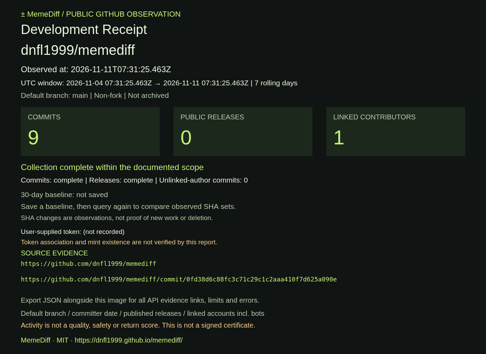

# Real historical Development Receipt example

**Real GitHub data, not a mock. Historical example—not current statistics.**

Repository: `dnfl1999/memediff` · observed **2026-11-11 07:31:25.463 UTC / 16:31:25.463 KST**.

- [Download the original PNG card](memediff-7d-2026-11-11.png)
- [Inspect the original JSON export](memediff-source-2026-11-11.json)
- [Successful live API QA run](https://github.com/dnfl1999/memediff/actions/runs/42979878190)
- [Source commit shown on the card](https://github.com/dnfl1999/memediff/commit/0fd38d6c88fc3c71c29c1c2aaa410f7d625a090e)

These files were copied unchanged from the public-site **real, unauthenticated GitHub API** QA artifact, not from fixture tests. No new observation was invented or relabeled as current. The PNG is 1400×1020 and displays a **7-day** window from 2026-11-04T07:31:25.463Z through 2026-11-11T07:31:25.463Z.

## How to read it

1. Check the repository and observed time at the top. A later query may produce different results.
2. The 7-day metrics are **9 commits, 0 public releases, 1 linked contributor**. These include documentation and maintenance commits; they are not a measure of effort or quality.
3. Collection was complete within the documented scope at that observation. In a partial receipt, a `+` and warning would appear; this real example was not altered to manufacture that state.
4. “30-day baseline: not saved” means no comparison is available. It does not claim zero change since a previous observation.
5. Follow the source URL and use the JSON for all observed commits and API evidence. The optional token field was left blank. This example makes no token-association claim.

**Why does the JSON say `selectedDays: 30`?** The live test exported JSON first, then switched to 7 days and exported PNG without querying again. The JSON preserves the same fetchedAt and includes both `metrics["7"]` and `metrics["30"]` plus the full 30-day source dataset. Both windows happened to have the same counts in this snapshot. The original exports are intentionally unedited; read `metrics["7"]` for the card.

To make your own: [open MemeDiff](https://dnfl1999.github.io/memediff/), enter a public repository, Analyze, select a period and download PNG Receipt plus JSON. See the [walkthrough](../GETTING_STARTED.md) and [FAQ](../FAQ.md). Do not share fixture screenshots as real development activity.

## v1.1 import compatibility sample (2026-11-12)

[Actual schema 1 JSON](memediff-v1.1-2026-11-12.json) was copied unchanged from the MEMEDIFF real-API public QA artifact of [Actions 43159340609](https://github.com/dnfl1999/memediff/actions/runs/43159340609), observed at 2026-11-12T05:12:13.929Z. It includes the official token CA and an imported-baseline comparison from the v1.1 roundtrip test. It is a historical, editable observation, not current statistics or a signed certificate. The v1.2 tests validate and recalculate its comparison without transmitting the file. Unlike the original November 11 repository-only sample, it requires the exact MEMEDIFF CA in the current report.
